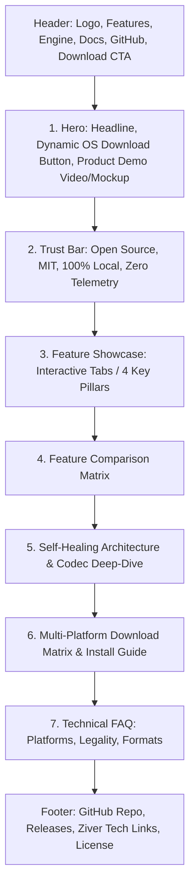

# ctrl+video: Marketing Analysis, Strategy & Website Plan

## 1. Executive Summary & Brand Positioning

**ctrl+video** is a desktop-first media downloader and frame-accurate clip-trimming studio engineered for power users, video editors, researchers, educators, and privacy-conscious digital creators.

### Core Value Proposition
> *"Professional desktop media extraction and sub-second clip trimming — 100% local, ad-free, and powered by yt-dlp & libmpv."*

### Brand Pillars
1. **Absolute Privacy & Zero Cloud Dependency**: Operates entirely on the local machine and network. No proxy servers, telemetry, user tracking, or cloud queues.
2. **Tactile Desktop Craftsmanship**: Built as a native desktop utility featuring a responsive 2-pane viewport-fitted workspace, keyboard shortcuts (`Space`, `I`, `O`, `Ctrl+K`), and a tactile dark-mode aesthetic with warm amber signal accents.
3. **Surgical Precision**: Goes beyond blunt video downloads by offering millisecond-exact trimming (`HH:MM:SS.mmm`), dynamic range inspection (HDR/SDR), and granular stream selection (AV1, VP9, H.264, Opus, FLAC).
4. **Self-Healing Core Engine**: Bundles standalone `yt-dlp` and `ffmpeg` binaries with built-in GitHub release checks, SHA-256 validation, and automatic rollback to ensure downloads never break when streaming platforms change.

---

## 2. Competitive Landscape & Market Differentiation

| Feature / Dimension | Web Downloaders (e.g., Y2Mate, SaveFrom) | Heavy Desktop GUIs (e.g., 4K Video Downloader) | Command-Line CLI (`yt-dlp` directly) | **ctrl+video** |
|---|---|---|---|---|
| **Privacy & Safety** | 🔴 Malicious popups, redirect ads, data harvesting | 🟡 Frequent paywalls, telemetry, license nag-screens | 🟢 100% local and open-source | 🟢 **100% local, zero ads, no telemetry** |
| **User Experience** | 🔴 Cluttered web UI, broken links, compression caps | 🟡 Generic bloated multi-window UI | 🔴 Steep terminal learning curve, manual flags | 🟢 **Two-pane keyboard-driven workspace + Command Palette** |
| **In-App Preview** | 🔴 None | 🔴 None / Post-download only | 🔴 None | 🟢 **Native libmpv low-bandwidth preview before downloading** |
| **Clip Trimming** | 🔴 None or server-side re-encoding paywall | 🔴 None (requires separate video editor) | 🟡 Complex `--download-sections` CLI syntax | 🟢 **Interactive timeline scrubber with Exact & Fast modes** |
| **Stream & Codec Picker** | 🔴 Capped at 720p/1080p MP4 | 🟡 Limited preset selection | 🟢 Full access to raw format IDs | 🟢 **Visual stream inspector (HDR, AV1, VP9, bitrate, size)** |
| **Engine Maintenance** | 🔴 Frequent downtime | 🟡 Delayed software updates | 🟡 Manual terminal upgrade commands | 🟢 **One-click self-healing engine with SHA-256 rollback** |

---

## 3. Target Audience & Buyer Personas

### Persona 1: The Video Editor & Content Creator ("Alex")
- **Pain Points**: Needs a 10-second reference clip or B-roll from a 2-hour livestream; downloading the entire 8 GB file wastes time, bandwidth, and storage.
- **Why ctrl+video Wins**: Native in-app preview + millisecond-precise timeline trimmer (`I` and `O` marks) with Exact mode (`--force-keyframes-at-cuts`) extracts just the needed cut directly into high-quality MP4/MKV.

### Persona 2: The Sound Designer & Music Archivist ("Sam")
- **Pain Points**: Web converters compress audio into low-bitrate fake MP3s with lossy transcoding artifacts.
- **Why ctrl+video Wins**: One-click audio extraction to lossless FLAC, native Opus, or 320kbps MP3 with codec transparency and metadata preservation.

### Persona 3: The Privacy & Open-Source Enthusiast ("Morgan")
- **Pain Points**: Disgusted by ad-riddled web services, suspicious browser extensions, and proprietary downloaders requiring paid subscriptions for 4K.
- **Why ctrl+video Wins**: Open-source MIT license, zero tracking, runs bundled `yt-dlp` locally, packaged natively for Linux (RPM/Tarball), macOS (Universal DMG), and Windows (Inno Setup EXE).

---

## 4. Marketing Website Architecture & Information Architecture

A single-page marketing website with focused sub-pages/modals designed to convert visitors into downloads:



---

## 5. Website Page Sections & Content Blueprint

### Section 1: Navigation Header
- **Brand**: `ctrl+video` tactile keycap logo.
- **Links**: `Features`, `Workflow`, `Sidecar Engine`, `Releases`, `Docs`.
- **Action**: GitHub Stars badge + Primary "Download v2.0" button.

### Section 2: Hero Section (Above the Fold)
- **Tagline**: *"The Keyboard-Driven Media Studio for Your Desktop."*
- **Sub-headline**: *"Download, inspect, and frame-accurately trim video and audio directly from your machine. Powered by yt-dlp, ffmpeg, and libmpv. 100% local, ad-free, and blazing fast."*
- **Primary CTA**: Smart OS detection button (e.g. `Download for Linux (.rpm)` / `Download for macOS (Universal .dmg)` / `Download for Windows (.exe)`).
- **Secondary CTA**: `View on GitHub` / `Read Documentation`.
- **Visual Asset**: High-resolution interactive mockup/video loop demonstrating the two-pane workspace, timeline scrubber, and Command Palette (`Ctrl+K`).

### Section 3: Feature Highlights (Interactive B-Roll Carousel / Tabs)
1. **In-App Stream Preview (`media_kit` + libmpv)**:
   - Preview content before downloading using bandwidth-efficient stream manifests.
   - Built-in playback shortcuts (`Space`, `←`/`→` 5s seeks).
2. **Frame-Accurate Timeline Trimming**:
   - Visual dual-handle scrubber.
   - **Exact Mode**: Re-encodes cut boundary frames for millisecond precision without downloading the whole file.
   - **Fast Mode**: Stream copy at nearest keyframes for instant extraction.
3. **Multi-Stream Codec Mastery**:
   - Inspect video/audio streams: AV1, VP9, H.264, AAC, Opus, FLAC.
   - Separate container options (MP4, MKV, WebM) and bitrate controls (320k, 192k, 128k).
4. **Command Palette & Two-Pane Workspace**:
   - Instant workflow with `Ctrl+K` / `Cmd+K` global launcher.
   - Viewport-fitted design with zero unnecessary scrolling.
5. **Self-Healing Engine**:
   - Automated `yt-dlp` updates with SHA-256 signature verification and atomic rollback.

### Section 4: Architecture & Trust (How It Works)
- Illustrated diagram showing the local-only data flow:
  `URL Input` ➔ `Local yt-dlp Engine` ➔ `libmpv Stream Preview` ➔ `Trim & Format Filter` ➔ `Local Storage (Drift SQLite History)`.
- Reassurance banner: *No middleman servers, no account registration, no subscription tiers.*

### Section 5: Cross-Platform Download Matrix
Dedicated cards with direct download links, SHA-256 checksums, and package manager commands:
- **Linux**: Single RPM package (`.rpm`) for Fedora/RHEL/openSUSE + tarball + terminal install command.
- **Windows**: Single Windows Setup Installer (`.exe`) with auto-shortcuts and clean uninstaller.
- **macOS**: Single Universal Apple Silicon + Intel Disk Image (`.dmg`).

### Section 6: Interactive Frequently Asked Questions (FAQ)
- *How does ctrl+video differ from online downloader sites?*
- *Do I need to install yt-dlp or ffmpeg manually?* (No, auto-bundled and self-updating).
- *Is it legal to download clips with this app?*
- *What platforms and streaming sites are supported?* (Hundreds supported via yt-dlp core).
- *Can I trim a 3-hour video without downloading the whole file?* (Yes, via `--download-sections`).

---

## 6. Website Technology Stack Recommendation

To maintain the same high-performance, minimalist aesthetic as the desktop app:
- **Framework**: **Astro** or **Next.js (Static Export)** with **Tailwind CSS**.
- **Design Tokens**: Mirror the desktop app's MD3 dark theme tokens:
  - Background: Deep Neutral Dark (`#131316`, `#0E0E11`)
  - Elevated Cards: `#1E1F24`, `#282A2F`
  - Accent / Signal Color: Warm Amber (`#F59E0B`)
  - Typography: Inter / Roboto + JetBrains Mono for technical specs and shortcuts
- **Interactive Components**:
  - Live OS detector for one-click downloading.
  - Interactive shortcut simulator (`Ctrl+K`, `I`, `O`, `Space`).
  - Interactive Format/Codec Selector demo.
- **Hosting**: GitHub Pages, Cloudflare Pages, or Vercel (Edge-delivered, static, zero backend costs).

---

## 7. Website Development Roadmap & Milestones

```
Phase 1: Brand & Asset Prep (Logo vectorization, UI screenshots, product video capture)
Phase 2: Content & Copywriting (Refining hero copy, technical specs, platform install guides)
Phase 3: Static Site Build (Responsive design, dark/light theme, interactive mockup, OS detection)
Phase 4: SEO, Analytics & Performance (OpenGraph cards, schema markup, 100/100 Lighthouse score)
Phase 5: Deployment & CI Automation (Auto-update latest release version & download links from GitHub API)
```
